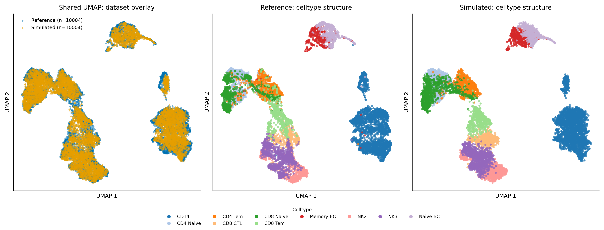
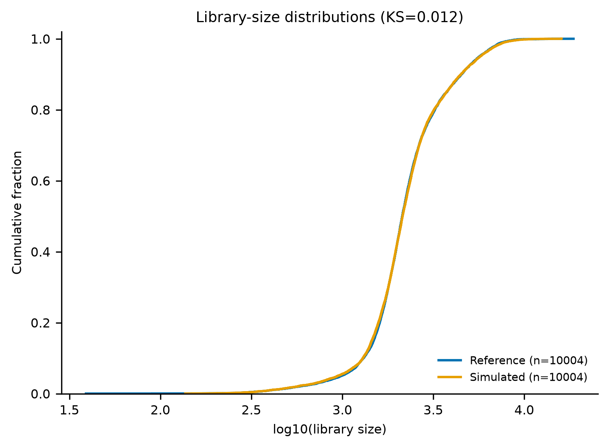
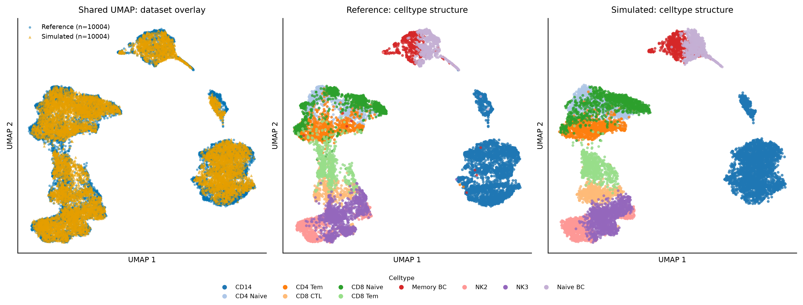
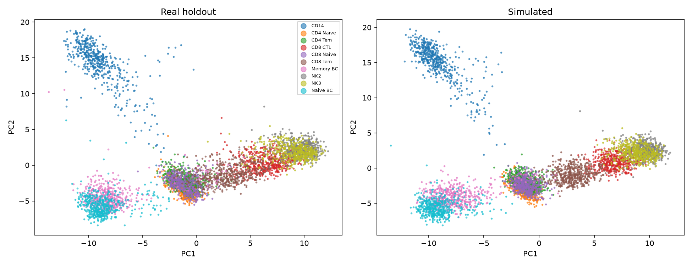
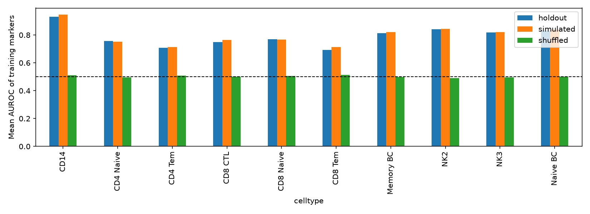
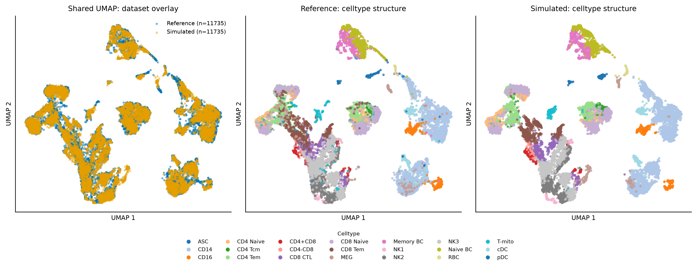
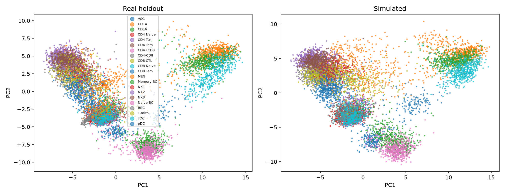
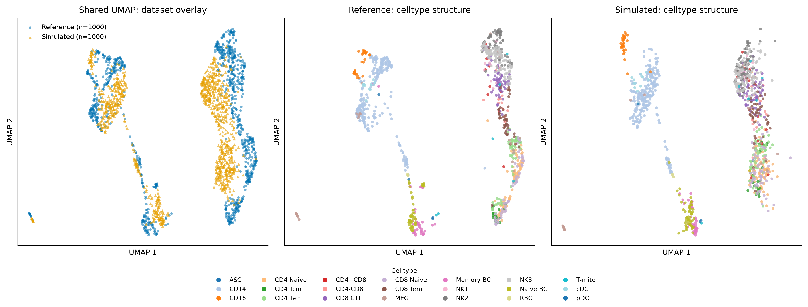
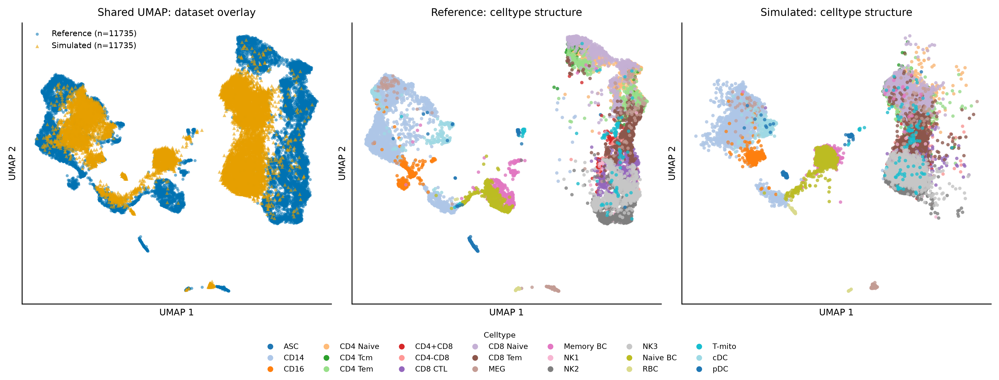
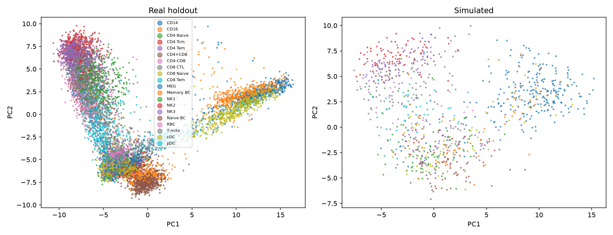

# Experiment Results

This directory contains the lightweight, GitHub-friendly evaluation artifacts
for `scRNARefGenerator`. Large simulated `.h5ad` files are intentionally not
committed and can be regenerated with:

```bash
FORCE=1 bash scripts/run_experiments.sh
bash scripts/evaluate_experiments_biological.sh
```

## Summary tables

- [`biological_summary_all.csv`](biological_summary_all.csv): all 16
  experiment configurations with similarity, marker, identity-transfer,
  nearest-neighbor, heterogeneity, and pass/fail metrics.
- [`biological_summary_all.json`](biological_summary_all.json): JSON version
  of the same results.
- [`experiment_configurations.csv`](experiment_configurations.csv): experiment
  grid, generated cell counts, condition columns, and output paths.

## Representative figures

### Main conditional pipeline





### Celltype subset experiment







### Celltype × ident experiment





### Unconditional experiment







Full interpretation is in [`../evaluation.md`](../evaluation.md).
